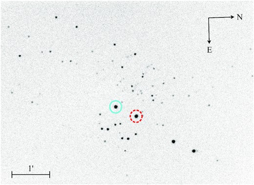

.. include:: ../../references.txt

Polarimetry Processing
======================

Start with :doc:`../../tutorials/polarimetry/halfwave` for complete half-wave and quarter-wave
workflows. This chapter explains the modulation models, fitting options, result
properties and coordinate-pairing helpers.

|astropop| processes dual-beam polarimetry with half-wave (HWP) or quarter-wave
(QWP) retarders. A half-wave sequence measures linear polarization; a
quarter-wave sequence can measure both linear and circular polarization.
The computation accepts extracted beam fluxes, so it does not depend on a
particular detector or source-extraction package. Savart and Wollaston analyzers
are examples of optical elements that separate the beams. Instruments using
dual-beam techniques include:

* IAGPOL [1]_ - Gaveta Polarimétrica do IAG `link <http://astroweb.iag.usp.br/~polarimetria/gaveta/default.htm>`_ at Observatório Pico dos Dias, Brazil
* SPARC4 [2]_ - Simultaneous Polarimeter and Rapid Camera in Four bands `link <http://www.das.inpe.br/sparc4>`_ at Observatório Pico dos Dias, Brazil
* LE2POL [3]_ - Leicester dual-beam imaging polarimeter at University of Leicester, UK
* FORS2 - FORS2, FOcal Reducer/low dispersion Spectrograph 2 at ESO, Chile, in IPOL mode. `link <https://www.eso.org/sci/facilities/paranal/instruments/fors/overview.html>`_
* POLIMA2 - Optical Dual-Beam Polarizer at OAN-SPM, Mexico. `link <https://www.astrossp.unam.mx/en/users/instruments/ccd-imaging/polima-2>`_

The analyzer separates orthogonally polarized ordinary and extraordinary
beams, producing two images of each source on the detector. Identify the
physical beams and calibrate their sign, throughput and angle conventions for
your instrument before fitting. The LE2POL image below illustrates the paired
source geometry [3]_.

   LE2POL image with an ordinary and extraordinary image of each star [3]_.

Description of the Polarimetry Reduction
----------------------------------------

The reduction follows the dual-beam method of Magalhães et al. [1]_ and
Rodrigues et al. [4]_, with least-squares fitting described by Campagnolo
(2019) [5]_. For each retarder position, the code computes the ordinary-minus-
extraordinary flux difference. Here :math:`F_o` is the ordinary flux and
:math:`F_e` is the extraordinary flux:

.. math::

    Z_i = \frac{F_o - F_e}{F_o + F_e}

The fitted modulation depends on the retarder:

* For half-wave plates, only linear polarization is computed, and the equation is:

  .. math::

    Z_i = Q \cos{4 \psi_i} + U \sin{4 \psi_i}

  .. plot::
    :include-source: false
    :alt: Half-wave modulation sampled at 22.5-degree retarder intervals.
    :caption: Linear polarization modulates the beam difference with a 90-degree period.

    import numpy as np
    import matplotlib.pyplot as plt
    from astropop.polarimetry import halfwave_model

    psi_lin = np.linspace(0, 360, 600)
    psi_i = np.arange(0, 361, 22.5)
    z_i = halfwave_model(psi_i, 0.12, -0.07)
    z_lin = halfwave_model(psi_lin, 0.12, -0.07)

    plt.figure(figsize=(5, 3))
    plt.plot(psi_lin, z_lin, '-', label='Model')
    plt.plot(psi_i, z_i, 'o', label='Data Points')
    plt.xlabel(r'$\psi_i$')
    plt.ylabel(r'$Z_i$')
    plt.title('Example of half-wave plate\nQ=0.12, U=-0.07')
    plt.legend()
    plt.tight_layout()
    plt.show()

* For quarter-wave plates, linear and circular polarization is computed, and the equation is:

  .. math::

    Z_i = Q \cos^2{2 \psi_i} + U \sin{2 \psi_i} \cos{2 \psi_i} - V \sin{2 \psi_i}

  .. plot::
    :include-source: false
    :alt: Quarter-wave modulation with linear and circular polarization.
    :caption: The circular component introduces a 180-degree period alongside the linear modulation.

    import numpy as np
    import matplotlib.pyplot as plt
    from astropop.polarimetry import quarterwave_model

    psi_lin = np.linspace(0, 360, 600)
    psi_i = np.arange(0, 361, 22.5)
    z_i = quarterwave_model(psi_i, 0.05, -0.07, 0.08)
    z_lin = quarterwave_model(psi_lin, 0.05, -0.07, 0.08)

    plt.figure(figsize=(5, 3))
    plt.plot(psi_lin, z_lin, '-', label='Model')
    plt.plot(psi_i, z_i, 'o', label='Data Points')
    plt.xlabel(r'$\psi_i$')
    plt.ylabel(r'$Z_i$')
    plt.legend()
    plt.title('Example of quarter-wave plate\nQ=0.05, U=-0.07, V=0.08')
    plt.tight_layout()
    plt.show()

Here :math:`Q`, :math:`U` and :math:`V` are normalized Stokes fractions,
returned as ``q``, ``u`` and ``v`` by the API, and :math:`\psi_i` is the
retarder angle. The model functions accept angles in degrees.

Normalization
^^^^^^^^^^^^^

Different beam throughput or extraction losses can require a normalization
factor :math:`k`. Astropop scales the extraordinary beam:

.. math::

    Z_i = \frac{F_o - k F_e}{F_o + k F_e}

Use a measured ``k=value`` or set ``compute_k=True`` to estimate it. The default,
``k=None`` with ``compute_k=False``, uses :math:`k=1`.

* For half-wave plates, the estimator groups measurements into four phases
  modulo 90 degrees: 0, 22.5, 45 and 67.5 degrees. It takes the median flux
  within each phase for each beam, ignoring NaNs, then uses

  .. math::

      k = \frac{\sum_{j=1}^{4} \widetilde{F}_{o,j}}
               {\sum_{j=1}^{4} \widetilde{F}_{e,j}}

  Each phase needs usable measurements in both beams. Check phase occupancy
  and finite fluxes before estimating normalization: a phase containing only
  NaNs raises ``ValueError``; a completely absent phase can currently produce
  an internal ``TypeError``. With one measurement per phase, this reduces to
  the ordinary-to-extraordinary total-flux ratio [1]_.

* For quarter-wave plates, :math:`Q\cos^2(2\psi_i)` generally has a nonzero
  mean, with the sign of :math:`Q`. The half-wave estimator therefore cannot
  be used unchanged. The code iterates the normalization and Stokes fit using
  the fitted :math:`Q`, following [4]_ and [6]_. Its initial phase ratio uses
  eight phases modulo 180 degrees, all of which need usable beam measurements.
  The convergence controls and current iteration behavior are described below.

Angle Zero of the Retarder
^^^^^^^^^^^^^^^^^^^^^^^^^^

The mechanical retarder zero need not coincide with the analyzer reference or
with the sky position-angle reference. The models evaluate ``psi + zero``.
A half-wave zero offset rotates the recovered ``q,u`` components and changes
``theta``, while preserving ``p = hypot(q,u)`` for an ideal rotation. It therefore
matters even for purely linear polarization. A half-wave sequence cannot
independently determine that offset and both linear Stokes components; observe
suitable standards to calibrate the sky-angle convention.

In the quarter-wave model, the zero also enters the circular modulation term.
An incorrect zero can mix the inferred components. Supply a measured zero when
available. A circularly polarized standard can help constrain a fitted zero;
the result still needs the instrument's beam-sign and sky-angle calibration.
Recheck calibration when the optical setup changes rather than assuming the
same offset applies indefinitely.

Polarimetry Reduction in |astropop|
-----------------------------------

Reduction involves pairing the two beam images, extracting their fluxes, and
fitting the modulation over retarder angle. The fitting API accepts arrays of
angles and beam fluxes; the pairing helpers accept arrays of measured ``x,y``
positions. You can use Astropop photometry or measurements from another package.

The following examples simulate fluxes to demonstrate the fitting interface.
The helper section separately demonstrates coordinate pairing. For a complete
read–fit–inspect–save workflow, use :doc:`../../tutorials/polarimetry/halfwave`.

Stokes-Least-Squares Polarimetry Processing
^^^^^^^^^^^^^^^^^^^^^^^^^^^^^^^^^^^^^^^^^^^

The Stokes-Least-Squares (SLS) method fits the modulation equations to the
relative beam-flux difference with the Trust Region Reflective least-squares
algorithm. See [5]_ for the method and its validation. The functions
``halfwave_model`` and ``quarterwave_model`` also evaluate the modulation directly,
which is useful for simulation and inspecting a fitted curve.

Create both kinds of beam sequence with a seeded Gaussian perturbation of
``zi``. These inputs illustrate the API; the perturbation is not a detector
photon-noise simulation. The tutorial provides a separate Poisson-count example.

.. code-block:: python

  import numpy as np
  rng = np.random.default_rng(42)
  from astropop.polarimetry import halfwave_model, quarterwave_model
  flux = 1e7  # total flux of the source, in electrons
  # retarder positions, in degrees
  psi_i = np.arange(0, 360, 22.5)

  # half-wave plate with only linear polarization
  # q=0.05, u=-0.07
  z_i_half = halfwave_model(psi_i, 0.05, -0.07)
  z_i_half = rng.normal(loc=z_i_half, scale=0.005)  # add some noise
  fo_half = flux*(1+z_i_half)/2  # ordinary beam fluxes
  fe_half = flux*(1-z_i_half)/2  # extraordinary beam fluxes

  # quarter-wave plate with linear and circular polarization
  # q=0.05, u=-0.07, v=0.08
  z_i_quarter = quarterwave_model(psi_i, 0.05, -0.07, 0.08)
  z_i_quarter = rng.normal(loc=z_i_quarter, scale=0.005)  # add some noise
  fo_quarter = flux*(1+z_i_quarter)/2  # ordinary beam fluxes
  fe_quarter = flux*(1-z_i_quarter)/2  # extraordinary beam fluxes

.. plot::
  :include-source: false
  :alt: Ordinary and extraordinary beam fluxes and their normalized differences for both retarder types.
  :caption: Simulated data for the Stokes-Least-Squares polarimetry processing.

  import numpy as np
  import matplotlib.pyplot as plt
  rng = np.random.default_rng(42)
  from astropop.polarimetry import halfwave_model, quarterwave_model
  flux = 1e7  # total flux of the source, in electrons
  # retarder positions, in degrees
  psi_i = np.arange(0, 360, 22.5)
  lin = np.linspace(0, 360, 360)

  fig, ax = plt.subplots(2, 2, figsize=(8, 6), sharex=True, sharey='row')

  # half-wave plate with only linear polarization
  # q=0.05, u=-0.07
  params_h = (0.05, -0.07)
  z_i_half = halfwave_model(psi_i, *params_h)
  z_i_half = rng.normal(loc=z_i_half, scale=0.005)
  fo_half = flux*(1+z_i_half)/2  # ordinary beam fluxes
  fe_half = flux*(1-z_i_half)/2  # extraordinary beam fluxes
  lin_e_half = flux*(1-halfwave_model(lin, *params_h))/2
  lin_o_half = flux*(1+halfwave_model(lin, *params_h))/2

  ax[0][0].plot(psi_i, fo_half, 'C0o', label='Ordinary')
  ax[0][0].plot(psi_i, fe_half, 'C1o', label='Extraordinary')
  ax[0][0].plot(lin, lin_o_half, 'C0--')
  ax[0][0].plot(lin, lin_e_half, 'C1--')
  ax[0][0].legend()
  ax[0][0].set_title('Half-wave plate\nQ=0.05, U=-0.07')
  ax[0][0].set_ylabel('Flux (e-)')

  ax[1][0].plot(psi_i, z_i_half, 'C2o')
  ax[1][0].plot(lin, halfwave_model(lin, 0.05, -0.07), 'C2--')
  ax[1][0].set_ylabel(r'Relative flux difference ($Z_i$)')
  ax[1][0].set_xlabel(r'Retarder position $\psi_i$ in (deg)')

  # quarter-wave plate with linear and circular polarization
  # q=0.05, u=-0.07, v=0.08
  params_q = (0.05, -0.07, 0.08)
  z_i_quarter = quarterwave_model(psi_i, *params_q)
  z_i_quarter = rng.normal(loc=z_i_quarter, scale=0.005)
  fo_quarter = flux*(1+z_i_quarter)/2  # ordinary beam fluxes
  fe_quarter = flux*(1-z_i_quarter)/2  # extraordinary beam fluxes
  lin_e_quarter = flux*(1-quarterwave_model(lin, *params_q))/2
  lin_o_quarter = flux*(1+quarterwave_model(lin, *params_q))/2

  ax[0][1].plot(psi_i, fo_quarter, 'C0o', label='Ordinary')
  ax[0][1].plot(psi_i, fe_quarter, 'C1o', label='Extraordinary')
  ax[0][1].plot(lin, lin_o_quarter, 'C0--')
  ax[0][1].plot(lin, lin_e_quarter, 'C1--')
  ax[0][1].legend()
  ax[0][1].set_title('Quarter-wave plate\nQ=0.05, U=-0.07, V=0.08')

  ax[1][1].plot(psi_i, z_i_quarter, 'C2o')
  ax[1][1].plot(lin, quarterwave_model(lin, *params_q), 'C2--')
  ax[1][1].set_xlabel(r'Retarder position $\psi_i$ in (deg)')

  ax[1][0].set_xticks(np.arange(0, 361, 45))
  ax[1][0].set_xlim(0, 360)

  fig.tight_layout()
  plt.show()

Create an `~astropop.polarimetry.SLSDualBeamPolarimetry`
^^^^^^^^^^^^^^^^^^^^^^^^^^^^^^^^^^^^^^^^^^^^^^^^^^^^^^^^

`~astropop.polarimetry.SLSDualBeamPolarimetry` stores the fitting options.
Choose ``'halfwave'`` to fit ``q,u`` or ``'quarterwave'`` to fit ``q,u,v``, then
call ``compute`` on one source's sequence of beam fluxes. Create separate
instances when observations need different normalization or zero calibrations.
These constructor examples show the common configurations:

.. code-block:: python

  from astropop.polarimetry import SLSDualBeamPolarimetry
  # half-wave plate
  s = SLSDualBeamPolarimetry('halfwave')
  # quarter-wave plate
  s = SLSDualBeamPolarimetry('quarterwave')
  # half-wave plate and tell the class to compute the k parameter
  s = SLSDualBeamPolarimetry('halfwave', compute_k=True)
  # quarter-wave plate with normalization and zero position at 45 degrees
  s = SLSDualBeamPolarimetry('quarterwave', compute_k=True, zero=45)

* ``k=value`` supplies a fixed normalization factor. ``compute_k=True``
  estimates the factor from the data and cannot be combined with a supplied
  ``k``. Leaving both arguments at their defaults uses ``k=1``.

* ``zero=value`` fixes the retarder offset in degrees; for example,
  ``zero=30.2`` uses 30.2 degrees in the model. With ``zero=None``, ``'halfwave'``
  uses zero degrees, while ``'quarterwave'`` fits the offset together with the
  Stokes components. ``zero_range=(0, 45)`` bounds a fitted offset to that
  interval; the default range is ``(0, 90)`` degrees.

* For a quarter-wave sequence with little or no circular signal, fitting both
  ``zero`` and ``k`` can be degenerate. A numerical fit does not establish that
  either calibration is identifiable. Prefer independently calibrated values;
  inspect residuals and uncertainties when fitting additional parameters.
  Circular polarization can help constrain the zero but is not a general
  guarantee of convergence or uniqueness.

* ``iter_tolerance`` and ``max_iters`` apply to quarter-wave normalization when
  ``compute_k=True``. The code compares successive ``q,u,v`` using
  ``np.allclose`` with ``atol=iter_tolerance`` and NumPy's default relative
  tolerance. The defaults are ``1e-5`` and 100 iterations. Currently the loop
  continues through its iteration budget even after recording convergence;
  it does not stop at the first successful comparison. If no comparison meets
  the criterion, ``compute`` raises ``RuntimeError``. These controls do not
  replace checks of angular coverage or physical calibration.

Stokes Parameters Computation
^^^^^^^^^^^^^^^^^^^^^^^^^^^^^

Call `~astropop.polarimetry.SLSDualBeamPolarimetry.compute` with matching arrays
of retarder positions in degrees and ordinary/extraordinary fluxes for one
source. The solver requires positions at multiples of 22.5 degrees, within
``psi_deviation`` (default 0.1 degrees). Optional beam errors must use the same
flux scale; their propagation and fit weighting are explained below.

For example, computing the Stokes parameters for the half-wave plate data without errors:

.. code-block:: python

  s = SLSDualBeamPolarimetry('halfwave')
  result = s.compute(psi_i, fo_half, fe_half)
  print(result)

And with errors:

.. code-block:: python

  s = SLSDualBeamPolarimetry('quarterwave', zero=0)
  # let's assume the errors are the square root of the fluxes
  fo_quarter_err = np.sqrt(fo_quarter)
  fe_quarter_err = np.sqrt(fe_quarter)
  result = s.compute(psi_i, fo_quarter, fe_quarter,
                     fo_quarter_err, fe_quarter_err)
  print(result)

Fit uncertainties and quality selection
^^^^^^^^^^^^^^^^^^^^^^^^^^^^^^^^^^^^^^^

Beam uncertainties propagate to ``zi``. The fit uses them as relative weights
only when **every** propagated uncertainty is positive. If any is zero or NaN,
the entire fit is unweighted. Supply finite fluxes and uncertainties and select
usable measurements before calling ``compute``; ``min_snr`` is currently an
unused compatibility parameter and does not reject low-SNR points.

The fitter uses ``scipy.optimize.curve_fit`` with its default
``absolute_sigma=False``: parameter covariance is scaled by the residual
variance. Returned Stokes errors are square roots of its diagonal, so noiseless
data can give almost zero fitted errors even with nonzero input errors.
The result does not retain the off-diagonal covariance; subsequent ``p`` and
``theta`` errors do not include correlations between fitted Stokes parameters.
Use ``theor_sigma`` for the separate flux-SNR estimate described below.

`~astropop.polarimetry.StokesParameters` class
^^^^^^^^^^^^^^^^^^^^^^^^^^^^^^^^^^^^^^^^^^^^^^

`~astropop.polarimetry.SLSDualBeamPolarimetry.compute` returns a
`~astropop.polarimetry.StokesParameters` container. It stores fitted ``q,u``
and, for quarter-wave data, ``v``, together with normalization, zero angle,
retarder positions, modulation and total flux when available. Most numerical
properties are |QFloat| values, carrying units and standard uncertainties.
The container also derives linear polarization, position angle and diagnostics.
It can be constructed directly from calibrated Stokes measurements, as the
low-polarization example below demonstrates.

The stored parameters are:

.. code-block:: python

  print(f'q={result.q}')
  print(f'u={result.u}')
  print(f'v={result.v}')
  print(f'k={result.k}')
  print(f'psi={result.psi}')
  print(f'z_i={result.zi}')
  print(f'zero={result.zero}')
  print(f'flux={result.flux}')

The linear polarization level is obtained from :math:`P=\sqrt{Q^2+U^2}` and is accessed by `~astropop.polarimetry.StokesParameters.p` property:

.. code-block:: python

  print(f'Linear polarization: {100 * result.p.nominal:.2f}%')

The position angle is :math:`\theta=\frac{1}{2}\operatorname{atan2}(U,Q)`, preserving the quadrant and reported modulo 180 degrees. It is accessed by `~astropop.polarimetry.StokesParameters.theta` property:

.. code-block:: python

  print(f'Position angle: {result.theta.nominal:.2f} deg')

Despite its name, `~astropop.polarimetry.StokesParameters.rms` returns the
population standard deviation of the residuals (``np.std``, ``ddof=0``), not
their root mean square. A constant residual offset does not contribute to this
statistic. Both ``zi`` and ``psi`` must be stored in the result.

.. code-block:: python

  print(f'Residual standard deviation: {result.rms:.4f}')

A theoretical expected error based on the fluxes SNR can be also computed by `~astropop.polarimetry.StokesParameters` using `~astropop.polarimetry.StokesParameters.theor_sigma` property. It is only available if ``flux`` is stored in the class.

.. code-block:: python

  print('Flux-SNR Stokes uncertainties:', result.theor_sigma)

Here ``SNR`` is the quadrature sum of the per-position total-flux SNRs,
``sqrt(sum((flux.nominal / flux.std_dev)**2))``. These estimates require meaningful
flux uncertainties and are separate from the residual-scaled fitted errors.
For ``halfwave`` retarders:

.. math::

  \sigma_P = \sigma_Q = \sigma_U = \frac{\sqrt{2}}{SNR}

and for ``quarterwave`` retarders it is:

.. math::

  \sigma_Q = \frac{1}{\sqrt{0.396} \cdot SNR}

.. math::

  \sigma_U = \frac{1}{\sqrt{0.1464} \cdot SNR}

.. math::

  \sigma_V = \frac{1}{\sqrt{0.4571} \cdot SNR}

.. math::

  \sigma_P = \frac{\sqrt{Q^2 \cdot \sigma_Q^2 + U^2\sigma_U^2}}{P}

The `~astropop.polarimetry.StokesParameters.model` property returns a callable
with the fitted parameters fixed. Its argument is the retarder position
``psi``; supply angular units when the stored zero angle carries units.

.. plot::
    :include-source: false
    :alt: Quarter-wave modulation values with measurement error bars and a model evaluated through StokesParameters.model.
    :caption: A seeded illustrative quarter-wave fit evaluated using result.model with angular units. The nominal modulation has added Gaussian noise; the supplied flux errors follow a separate square-root recipe.

    import matplotlib.pyplot as plt
    import numpy as np
    from astropy import units as u
    from astropop.polarimetry import SLSDualBeamPolarimetry, quarterwave_model

    rng = np.random.default_rng(42)
    psi = np.arange(0, 360, 22.5)
    zi = quarterwave_model(psi, 0.05, -0.07, 0.08) + rng.normal(0, 0.005, len(psi))

    # Split a fixed total flux according to the normalized beam difference.
    ordinary, extraordinary = 1e7 * (1 + zi) / 2, 1e7 * (1 - zi) / 2
    result = SLSDualBeamPolarimetry('quarterwave', zero=0).compute(
        psi, ordinary, extraordinary, np.sqrt(ordinary), np.sqrt(extraordinary))
    line = np.linspace(0, 360, 300)
    prediction = result.model(line * u.deg).nominal
    fig, ax = plt.subplots(figsize=(6, 3.6), layout='constrained')
    ax.errorbar(psi, result.zi.nominal, yerr=result.zi.uncertainty, fmt='o', label='Measurements')
    ax.plot(line, prediction, '--', label='result.model')
    ax.set(xlabel='Retarder angle (deg)', ylabel='Normalized beam difference')
    ax.legend()

Low linear polarization and angle precision
^^^^^^^^^^^^^^^^^^^^^^^^^^^^^^^^^^^^^^^^^^^

The angle is half the direction of the ``q,u`` vector. Near the origin, small
changes in either component can change that direction substantially. Construct
three measurements with the same small polarization and relatively large
component errors::

    >>> from astropop.math import QFloat
    >>> from astropop.polarimetry import StokesParameters

    >>> for q, u in ((0.001, 0.), (0., 0.001), (-0.001, 0.)):
    ...     low = StokesParameters('halfwave', q=QFloat(q, 0.002), u=QFloat(u, 0.002))
    ...     print(f'q={q:+.3f}, u={u:+.3f}: theta={low.theta.nominal:.1f} +/- {low.theta.uncertainty:.1f} deg')
    q=+0.001, u=+0.000: theta=0.0 +/- 57.2 deg
    q=+0.000, u=+0.001: theta=45.0 +/- 57.2 deg
    q=-0.001, u=+0.000: theta=90.0 +/- 57.2 deg

``theta.uncertainty`` uses the approximation ``28.6 * p.uncertainty / p.nominal``
in degrees. It is undefined at zero linear polarization and should not be
interpreted as a calibrated confidence interval at low signal-to-noise.
The nonnegative ``p = hypot(q,u)`` also has positive noise bias; Astropop does
not apply a debiasing estimator. For inference in that regime, use an appropriate
polarization likelihood and interval method; see the original statistical
analysis of `polarization fraction and angle estimators
<https://www.aanda.org/articles/aa/full_html/2015/02/aa24451-14/aa24451-14.html>`_.

Helper Tools
------------

A dual-beam image contains two detections for each physical source.
`~astropop.polarimetry.estimate_dxdy` estimates their common displacement;
`~astropop.polarimetry.match_pairs` associates detections using that displacement.
Both work with pixel positions, independently of the flux-fitting API.

Create a field with 80 pairs separated by ``(+25,+35)`` pixels::

    >>> import numpy as np

    >>> rng = np.random.default_rng(42)
    >>> base_x = rng.uniform(0, 950, 80)
    >>> base_y = rng.uniform(0, 950, 80)
    >>> x = np.concatenate((base_x, base_x + 25))
    >>> y = np.concatenate((base_y, base_y + 35))

    >>> print('Detections:', len(x), '; physical sources:', len(base_x))
    Detections: 160 ; physical sources: 80

Displacement Computation
^^^^^^^^^^^^^^^^^^^^^^^^

``estimate_dxdy`` forms detection pairs with ``y[j] > y[i]`` and computes
``x[i] - x[j]`` and ``y[i] - y[j]``. Thus the displacement for this field is
negative, although the second copy was constructed with positive offsets.
``dist_limit`` restricts the absolute difference along each axis in pixels.
The estimator locates the histogram mode, then refines it in successively
narrower ranges. ``steps=[50, 5, 3, 1]`` uses those pixel half-widths around the
preceding estimate; ``bins`` controls histogram resolution within each range.

Estimate the displacement from the generated detections::

    >>> from astropop.polarimetry import estimate_dxdy

    >>> dx, dy = estimate_dxdy(x, y, dist_limit=50, steps=[50, 5, 3, 1], bins=100)

    >>> print(f'dx = {dx:.2f} pixels; dy = {dy:.2f} pixels')
    dx = -25.00 pixels; dy = -35.00 pixels

Position errors, unrelated neighbors and histogram settings affect the
estimate. Use an instrument calibration field and inspect the matches; the
method assumes a useful common displacement. Pair construction grows
quadratically with detection count, so select a manageable sample rather than
passing every detection in a large survey at once.

Pairs Matching
^^^^^^^^^^^^^^

``match_pairs`` searches a `~scipy.spatial.cKDTree` for a neighbor near
``(x - dx, y - dy)`` for each detection. ``tolerance`` is the maximum Euclidean
matching distance in pixels. The structured NumPy array contains indices into
the supplied positions, with fields ``'o'`` for the starting detection and
``'e'`` for its matched neighbor. Sorting the detections first does not change
this indexing contract::

    >>> from astropop.polarimetry import match_pairs

    >>> # Apply the same permutation to both coordinate arrays to preserve detections.
    >>> sorting = np.argsort(y)
    >>> x, y = x[sorting], y[sorting]
    >>> pairs = match_pairs(x, y, dx, dy, tolerance=2.)

    >>> print('Matched pairs:', len(pairs))
    Matched pairs: 80

    >>> n = 0

    >>> # The pair entries are indices into the sorted detection arrays.
    >>> index_o, index_e = pairs['o'][n], pairs['e'][n]
    >>> x_o, y_o = x[index_o], y[index_o]
    >>> x_e, y_e = x[index_e], y[index_e]

    >>> print(f'Pair {n}: x_e-x_o={x_e-x_o:.1f}, y_e-y_o={y_e-y_o:.1f} pixels')
    Pair 0: x_e-x_o=25.0, y_e-y_o=35.0 pixels

.. note::

    The ``'o'`` and ``'e'`` fields identify geometric matches. Establish which
    physical beam is ordinary from your instrument convention before supplying
    fluxes to ``compute``. Swapping beams changes the modulation sign and the
    normalization interpretation. Independent nearest-neighbor queries do not
    enforce a unique global assignment; check duplicates and crowded matches.

The diagram uses three separated pairs so the displacement sign and returned
indices are visible without crowding. The arrows run from each ``'o'`` detection
to the neighbor at ``(x-dx,y-dy)``:

.. plot::
    :include-source: false
    :alt: Three geometric pairs separated by positive 25 and 35 pixels, labeled with the indices returned by match_pairs using negative dx and dy.
    :caption: Geometric pair indices and the sign convention of match_pairs. Physical beam identification requires an instrument calibration.

    import numpy as np
    import matplotlib.pyplot as plt
    from astropop.polarimetry import match_pairs

    base = np.array([[20, 20], [110, 30], [70, 100]])
    positions = np.vstack((base, base + [25, 35]))

    # The matcher takes (x_o - x_e, y_o - y_e), opposite to the drawn arrows.
    pairs = match_pairs(positions[:, 0], positions[:, 1], -25, -35, tolerance=2)
    fig, ax = plt.subplots(figsize=(6, 4))
    for pair in pairs:
        o, e = int(pair['o']), int(pair['e'])
        start, end = positions[o], positions[e]
        ax.plot(*start, 'o', color='C0')
        ax.plot(*end, '^', color='C1')
        ax.annotate('', xy=end, xytext=start,
                    arrowprops={'arrowstyle': '->', 'color': '0.4'})
        ax.annotate(f'o[{o}]', start, xytext=(-4, -12), textcoords='offset points')
        ax.annotate(f'e[{e}]', end, xytext=(4, 2), textcoords='offset points')

    ax.set(xlabel='x (pixel)', ylabel='y (pixel)', xlim=(0, 155), ylim=(0, 155),
           title='Neighbor offset: (-dx, -dy) = (+25, +35) pixel')
    ax.set_aspect('equal')
    fig.tight_layout()

References
----------
.. [1] Magalhães et al. 1996. `bibcode: 1996ASPC...97..118M <https://ui.adsabs.harvard.edu/abs/1996ASPC...97..118M>`_

.. [2] Rodrigues et al. 2011. `bibcode: 2012AIPC.1429..252R <https://ui.adsabs.harvard.edu/abs/2012AIPC.1429..252R>`_

.. [3] Wiersema et al. 2023. `doi: 10.1093/rasti/rzad005 <https://doi.org/10.1093/rasti/rzad005>`_

.. [4] Rodrigues et al. 1998. `bibcode: 1998A&A...335..979R <https://ui.adsabs.harvard.edu/abs/1998A&A...335..979R>`_

.. [5] Campagnolo, 2019. `bibcode: 2019PASP..131b4501N <https://ui.adsabs.harvard.edu/abs/2019PASP..131b4501N>`_

.. [6] Lima et al. 2021. `bibcode: 2021AJ....161..225L <https://ui.adsabs.harvard.edu/abs/2021AJ....161..225L>`_

Reference/API
-------------

.. automodapi:: astropop.polarimetry
  :no-inheritance-diagram:
  :inherited-members:

.. currentmodule:: None
